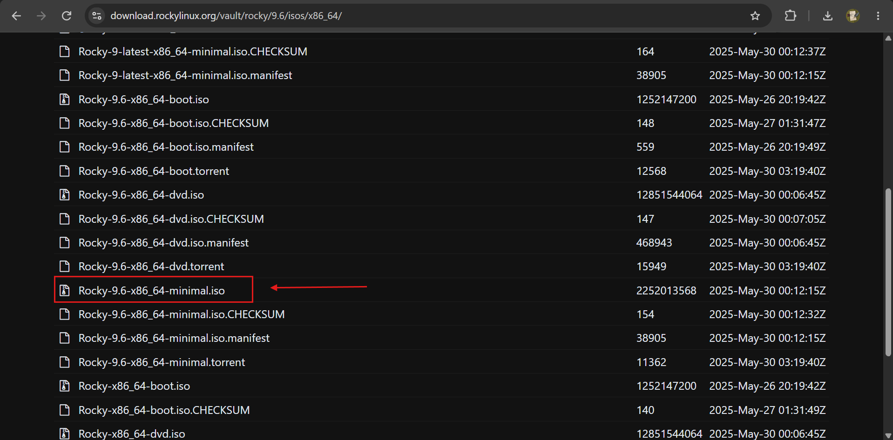
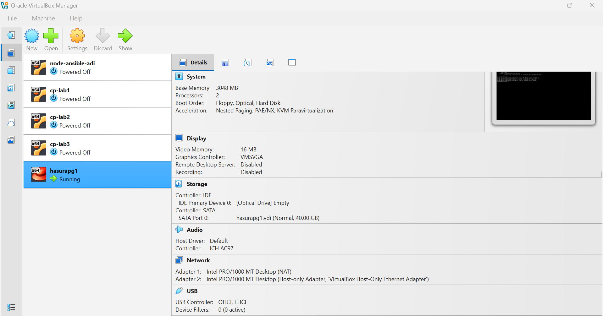

# download os rocky linux 9.6 
https://download.rockylinux.org/vault/rocky/9.6/isos/x86_64/



pilih minimal.iso os

# create vm hasurapg1
default ip : DHCP
static ip : 192.168.56.30
user : hasura, pw: password



note: clone untuk 2 vm lainnya

## set user hasura ke akses root

```bash
su -
usermod -aG wheel hasura
id hasura
exit
# login ulang dengan user hasura
```

## set hostname & static ip manual

hasurapg2
```bash
sudo hostnamectl set-hostname hasurapg3
hostnamectl

nmcli connection show

sudo nmcli connection modify enp0s8 \
ipv4.method manual \
ipv4.addresses 192.168.56.31/24 \
ipv4.never-default yes \
ipv4.gateway "" \
ipv4.dns ""

sudo nmcli connection up enp0s8

ip a
```

hasurapg3
```bash
sudo hostnamectl set-hostname hasurapg3
hostnamectl

nmcli connection show

sudo nmcli connection modify enp0s8 \
ipv4.method manual \
ipv4.addresses 192.168.56.32/24 \
ipv4.never-default yes \
ipv4.gateway "" \
ipv4.dns ""

ip a
```

## tambah hosts di 3 node

```bash
sudo tee -a /etc/hosts <<EOF
192.168.56.30 hasurapg1
192.168.56.31 hasurapg2
192.168.56.32 hasurapg3
EOF
```

## set keygen baru untuk ssh

```bash
sudo rm -f /etc/ssh/ssh_host_*
sudo ssh-keygen -A
sudo systemctl restart sshd
```

## cek firewall dan rule yang ada

```bash
sudo systemctl status firewalld

sudo firewall-cmd --list-ports
sudo firewall-cmd --list-services
```

jika belum aktif jalankan `sudo systemctl enable --now firewalld`